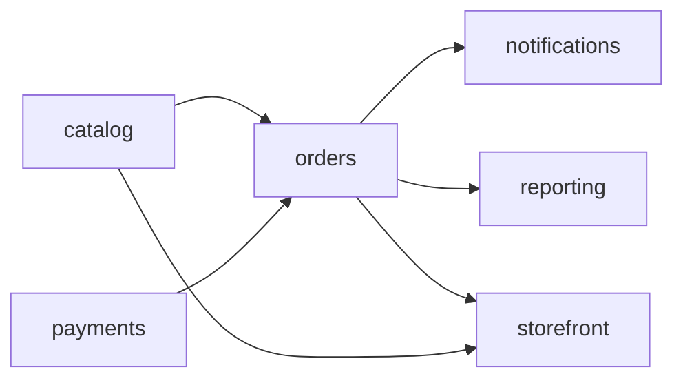

# Dependency Release Planner

An offline Python demo that turns a changed-service list into a deterministic impact report and dependency-ordered rebuild/test batches. Useful for exploring selective CI in a small service graph. It does not deploy services or modify repositories.

## Example

The synthetic graph describes dependencies, not consumers:



An arrow means “is a prerequisite of”. In JSON, `"orders": ["catalog", "payments"]` means orders depends on catalog and payments.

```bash
python -m venv .venv
. .venv/bin/activate
pip install -e '.[dev]'
releaseplan examples/services.json --changed payments
```

The output includes:

```json
{
  "changed": ["payments"],
  "affected": ["notifications", "orders", "payments", "reporting", "storefront"],
  "unaffected": ["catalog"],
  "batches": [["payments"], ["orders"], ["notifications", "reporting", "storefront"]],
  "external_prerequisites": ["catalog"]
}
```

See [the generated report](examples/plan.json) for the complete machine-readable example. An empty `--changed` list yields an empty plan, not a rebuild of everything.

## Design

1. Validate all declared nodes and edges. Reject undeclared dependencies, duplicate edges, self-dependencies and malformed input.
2. Validate the entire graph with Kahn-style topological layers, including components unrelated to the change.
3. Traverse reverse edges to compute transitive consumers of changed services.
4. Build sorted layers for that affected subset. Unchanged dependencies are reported as external prerequisites and assumed available.

Stable lexicographic ordering makes reports independent of JSON object ordering. A cycle reports all services blocked by it, which can include downstream consumers: it is not a claim that every listed node belongs to the cycle. The input object is not mutated.

The implementation favors transparent batch planning over maximum scale: repeated layer scans are quadratic in the worst case of a long chain. It uses no third-party runtime dependencies.

## Library

```python
from releaseplan.core import plan

report = plan({"db": [], "api": ["db"], "web": ["api"]}, ["api"])
assert report["batches"] == [["api"], ["web"]]
assert report["external_prerequisites"] == ["db"]
```

CLI exit codes: `0` for a valid plan, `2` for malformed JSON, inaccessible input or an invalid graph/change list. Diagnostics go to stderr, successful JSON to stdout.

## Checks

```bash
pytest -q
ruff check .
ruff format --check .
python -m pip wheel --no-deps . -w dist
```

Tests cover transitive impact, diamonds, unrelated nodes, deterministic ordering, cycles and downstream diagnostics, malformed inputs, an empty change list, CLI errors and a 300-node chain. CI runs tests, lint, formatting and wheel packaging on Python 3.11 and 3.12.

## Scope

This is a portfolio demo on synthetic service data, not a production release system or evidence of employment work. It has no scheduler, repository diff detection, deployment, rollback, artifact compatibility analysis or live CI integration. A batch says only that graph prerequisites are satisfied; resource capacity, runtime compatibility and release safety require separate checks.
